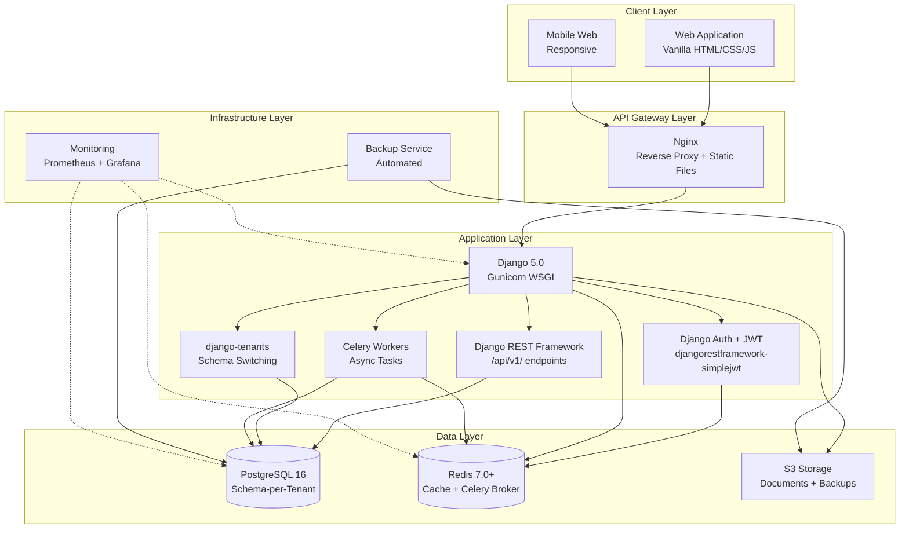
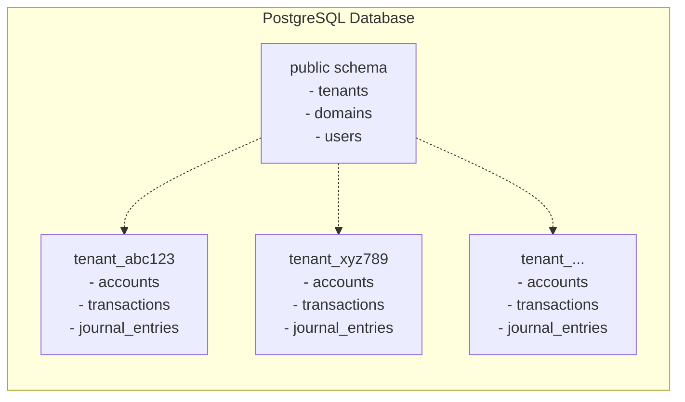
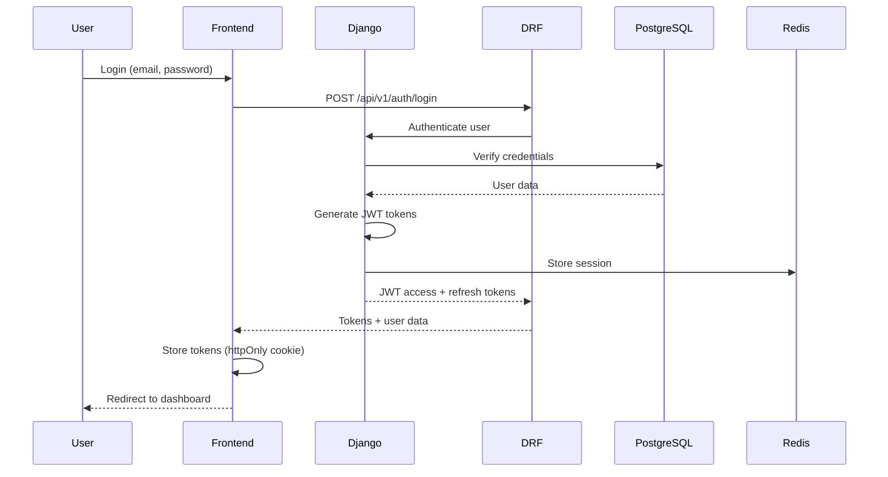
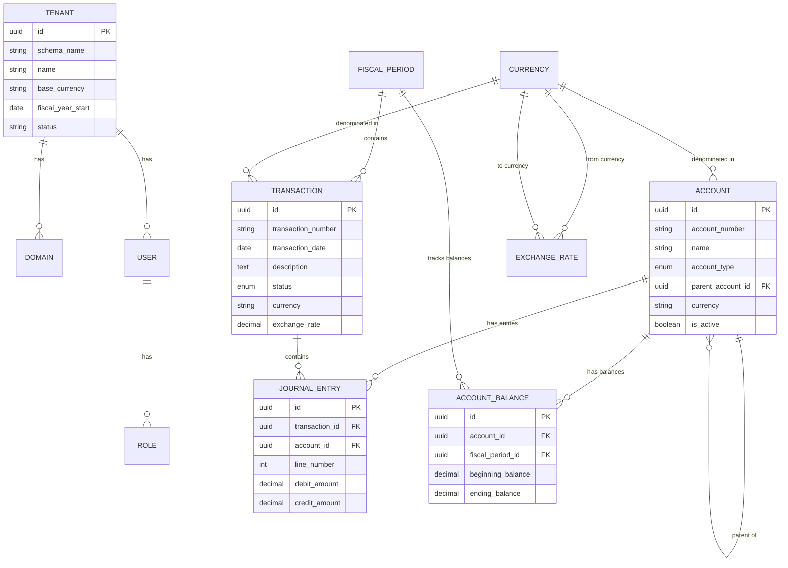

# Design Document: Enterprise ERP System - Phase 1 (Finance Module)

## Overview

### Vision and Approach

The Enterprise ERP System Phase 1 delivers a production-ready Finance module that combines SAP's comprehensive functionality with ERPNext's user-friendly simplicity. This design establishes the architectural foundation for all future modules while providing immediate business value through complete financial management capabilities.

**Design Philosophy:**
- **Comprehensive yet Simple**: Full enterprise functionality without enterprise complexity
- **Modular Architecture**: Clean separation enabling independent module deployment via Django apps
- **Production-First**: Every component designed for real-world operational demands
- **Future-Proof Foundation**: Architecture supports seamless addition of future modules (HR, SCM, CRM)

### Phase 1 Scope

Phase 1 focuses exclusively on the Finance module with complete supporting infrastructure:

**Core Finance Capabilities:**
- Double-entry bookkeeping with full GAAP compliance
- Multi-currency support with automated exchange rate management
- Real-time financial reporting and analytics
- Audit trail with cryptographic integrity
- Fiscal period management and closing
- Complete Finance sub-modules: Accounts, Ledger, Invoicing, Payments, Tax, Reporting, Budgeting, Fixed Assets, Bank Reconciliation, Expense Management

**Supporting Infrastructure:**
- Multi-tenant architecture with complete data isolation (django-tenants)
- Authentication and role-based authorization (Admin, Accountant, Finance Manager, Auditor)
- RESTful API with Django REST Framework (versioned endpoints at /api/v1/)
- Data import/export with validation
- Backup and disaster recovery
- System monitoring and health checks
- Security and encryption (CSRF, JWT, input validation, audit logging)

### Technology Stack

**Frontend:**
- **Core**: Vanilla HTML5, CSS3, JavaScript (ES6+)
- **UI Framework**: None (custom components for maximum control and simplicity)
- **Styling**: Custom CSS with CSS variables for theming, CSS Grid and Flexbox for layouts
- **Forms**: Native HTML5 form validation + custom JavaScript validation
- **Charts**: Chart.js for financial visualizations
- **AJAX**: Fetch API for asynchronous requests to Django REST API
- **Module Pattern**: ES6 modules for code organization
- **Build Tools**: Minimal - Django's static file handling with optional Webpack for bundling

**Backend:**
- **Framework**: Django 5.0 (Python 3.12+)
- **API**: Django REST Framework 3.14+ with /api/v1/ versioned endpoints
- **Authentication**: Django's built-in auth + JWT (djangorestframework-simplejwt)
- **Multi-Tenancy**: django-tenants 3.5+ (schema-per-tenant isolation)
- **Validation**: Django Forms, DRF Serializers, custom validators
- **Task Queue**: Celery 5.3+ with Redis backend for async processing
- **Admin Interface**: Django Admin (customized for ERP workflows)

**Django Apps Structure:**
- **core**: Shared utilities, base models, middleware
- **tenants**: Multi-tenant management (extends django-tenants)
- **accounts**: Chart of accounts, account management
- **ledger**: General ledger, journal entries, transactions
- **invoicing**: Customer invoices, vendor bills
- **payments**: Payment processing, receipts
- **tax**: Tax calculations, tax reports
- **reporting**: Financial reports, dashboards
- **budgeting**: Budget planning, variance analysis
- **fixed_assets**: Asset tracking, depreciation
- **bank_reconciliation**: Bank statement matching
- **expense_management**: Expense tracking, reimbursements

**Database:**
- **Primary Database**: PostgreSQL 16
- **Multi-Tenancy Pattern**: Schema-per-tenant via django-tenants (optimal balance of isolation and cost)
- **ORM**: Django ORM (mature, battle-tested, excellent for complex queries)
- **Migrations**: Django migrations for version-controlled schema changes
- **Connection Pooling**: PgBouncer for efficient connection management

**Infrastructure:**
- **Web Server**: Gunicorn (WSGI) + Nginx (reverse proxy, static files)
- **Containerization**: Docker with multi-stage builds
- **Orchestration**: Kubernetes for production deployment
- **Caching**: Redis 7.0+ for session storage, Celery broker, and application caching
- **Message Queue**: Celery + Redis for async processing (reports, imports, exports)
- **Object Storage**: S3-compatible storage for documents and backups
- **Monitoring**: Prometheus + Grafana for metrics, structured logging with Python logging

**Development Tools:**
- **Package Manager**: pip with requirements.txt or Poetry
- **Virtual Environment**: venv or virtualenv
- **Testing**: pytest (unit), pytest-django, Hypothesis (property-based), Selenium (E2E)
- **Code Quality**: pylint, black (formatter), mypy (type checking), isort
- **CI/CD**: GitHub Actions with automated testing and deployment

### Key Design Decisions

**1. Django Framework Choice**

Django provides significant advantages for enterprise ERP systems:
- **Batteries Included**: ORM, admin interface, authentication, forms, validation out of the box
- **Mature Ecosystem**: 18+ years of development, proven in enterprise environments
- **Security**: Built-in protection against SQL injection, XSS, CSRF, clickjacking
- **Admin Interface**: Powerful admin interface that can be customized for ERP workflows
- **ORM**: Sophisticated ORM with support for complex queries, transactions, and database features
- **Scalability**: Powers Instagram, Pinterest, Mozilla - proven at scale

**2. Schema-per-Tenant Multi-Tenancy (django-tenants)**

We chose schema-per-tenant over database-per-tenant or row-level security based on:
- **Isolation**: Strong logical separation without physical database overhead
- **Performance**: Efficient query plans without tenant_id filtering on every query
- **Cost**: Single database instance serves 10,000+ tenants
- **Scalability**: Easy to move large tenants to dedicated databases if needed
- **Backup/Restore**: Per-tenant backup and restore capabilities
- **Django Integration**: django-tenants provides seamless schema switching

**3. Vanilla JavaScript over Heavy Frameworks**

Vanilla JavaScript provides advantages for ERP simplicity:
- **No Framework Lock-in**: No React/Vue/Angular complexity or breaking changes
- **Performance**: Zero framework overhead, faster page loads
- **Simplicity**: Easier for developers to understand and maintain
- **Progressive Enhancement**: Works without JavaScript, enhanced with it
- **Long-term Stability**: No framework version migrations or deprecations
- **Server-Side Rendering**: Django templates handle most rendering, JS for interactivity

**4. Modular Django Apps Architecture**

Django apps provide clean module separation:
- **Reusability**: Each app (accounts, invoicing, payments) is self-contained
- **Maintainability**: Clear boundaries between modules
- **Team Scalability**: Different teams can work on different apps
- **Future Modules**: Easy to add HR, SCM, CRM as new Django apps
- **Testing**: Each app can be tested independently

**5. RBAC Roles for Finance Module**

Four distinct roles for Phase 1:
- **Admin**: Full system access, user management, configuration
- **Accountant**: Transaction entry, journal entries, account management
- **Finance Manager**: Approvals, reporting, budget oversight
- **Auditor**: Read-only access to all financial data and audit logs


## Architecture

### System Architecture



### Multi-Tenant Architecture

**Schema-per-Tenant Implementation with django-tenants:**



**Tenant Isolation Mechanism:**

1. **Request Arrives**: HTTP request to subdomain.example.com
2. **Domain Resolution**: django-tenants middleware extracts subdomain
3. **Tenant Lookup**: Queries public.tenants table by domain
4. **Schema Selection**: `connection.set_schema(tenant.schema_name)`
5. **Query Execution**: All Django ORM queries automatically scoped to tenant schema
6. **Response**: Data returned only from tenant's schema

**Benefits:**
- No tenant_id columns needed in application tables
- Database enforces isolation at schema level
- Query plans optimized per tenant
- Easy to audit and backup per tenant
- Can move large tenants to dedicated databases without code changes

### Security Architecture

**Authentication Flow:**



**Authorization Model:**

- **Role-Based Access Control (RBAC)**: Users assigned to roles (Admin, Accountant, Finance Manager, Auditor)
- **Permission-Based**: Django permissions system with custom permissions per model
- **Resource-Level**: Permissions scoped to specific resources via Django Guardian (optional)
- **Hierarchical**: Roles can inherit permissions

**Security Layers:**

1. **Transport Security**: TLS 1.3 for all connections
2. **Authentication**: JWT with short expiry (15 min) + refresh tokens (7 days)
3. **Authorization**: Django permission checks on every view/API endpoint
4. **Data Encryption**: AES-256 for sensitive fields at rest (django-encrypted-model-fields)
5. **Audit Logging**: All access and modifications logged
6. **Rate Limiting**: django-ratelimit for per-user and per-tenant limits
7. **Input Validation**: DRF serializers + Django forms for all inputs
8. **SQL Injection Prevention**: Django ORM parameterized queries
9. **XSS Prevention**: Django template auto-escaping + Content Security Policy headers
10. **CSRF Protection**: Django CSRF middleware + tokens


## Components and Interfaces

### Django Apps Structure

#### 1. Core App (core/)

**Responsibilities:**
- Base models and mixins
- Shared utilities and helpers
- Custom middleware
- Common validators

**Key Models:**
```python
# core/models.py
from django.db import models
from django.contrib.auth.models import User

class TimeStampedModel(models.Model):
    """Abstract base model with created/updated timestamps"""
    created_at = models.DateTimeField(auto_now_add=True)
    updated_at = models.DateTimeField(auto_now=True)
    created_by = models.ForeignKey(User, on_delete=models.PROTECT, related_name='+')
    updated_by = models.ForeignKey(User, on_delete=models.PROTECT, related_name='+')
    
    class Meta:
        abstract = True
```

#### 2. Tenants App (tenants/)

**Responsibilities:**
- Tenant provisioning and management
- Domain management
- Tenant configuration
- Schema creation and migration

**Key Models:**
```python
# tenants/models.py
from django_tenants.models import TenantMixin, DomainMixin
from django.db import models

class Tenant(TenantMixin):
    name = models.CharField(max_length=255)
    base_currency = models.CharField(max_length=3, default='USD')
    fiscal_year_start = models.DateField()
    timezone = models.CharField(max_length=50, default='UTC')
    locale = models.CharField(max_length=10, default='en-US')
    status = models.CharField(
        max_length=20,
        choices=[('active', 'Active'), ('suspended', 'Suspended'), ('deleted', 'Deleted')],
        default='active'
    )
    
    auto_create_schema = True

class Domain(DomainMixin):
    pass
```

**Key Services:**
```python
# tenants/services.py
from django_tenants.utils import schema_context

class TenantService:
    @staticmethod
    def create_tenant(name: str, subdomain: str, config: dict) -> Tenant:
        """Create new tenant with isolated schema"""
        tenant = Tenant.objects.create(
            schema_name=f'tenant_{subdomain}',
            name=name,
            **config
        )
        Domain.objects.create(
            domain=f'{subdomain}.example.com',
            tenant=tenant,
            is_primary=True
        )
        return tenant
    
    @staticmethod
    def delete_tenant(tenant_id: str) -> None:
        """Delete tenant and all associated data"""
        tenant = Tenant.objects.get(id=tenant_id)
        tenant.delete()  # django-tenants handles schema deletion
```

#### 3. Accounts App (accounts/)

**Responsibilities:**
- Chart of accounts management
- Account hierarchy
- Account types and subtypes
- Account validation

**Key Models:**
```python
# accounts/models.py
from django.db import models
from core.models import TimeStampedModel

class AccountType(models.TextChoices):
    ASSET = 'asset', 'Asset'
    LIABILITY = 'liability', 'Liability'
    EQUITY = 'equity', 'Equity'
    REVENUE = 'revenue', 'Revenue'
    EXPENSE = 'expense', 'Expense'

class Account(TimeStampedModel):
    account_number = models.CharField(max_length=20, unique=True)
    name = models.CharField(max_length=255)
    account_type = models.CharField(max_length=20, choices=AccountType.choices)
    parent_account = models.ForeignKey('self', null=True, blank=True, on_delete=models.PROTECT)
    currency = models.CharField(max_length=3, default='USD')
    is_active = models.BooleanField(default=True)
    is_system = models.BooleanField(default=False)
    description = models.TextField(blank=True)
    
    class Meta:
        ordering = ['account_number']
        indexes = [
            models.Index(fields=['account_type']),
            models.Index(fields=['parent_account']),
        ]
```

**API Endpoints:**
```python
# accounts/views.py
from rest_framework import viewsets, permissions
from rest_framework.decorators import action
from .models import Account
from .serializers import AccountSerializer

class AccountViewSet(viewsets.ModelViewSet):
    """
    API endpoints for account management
    
    list: GET /api/v1/accounts/
    create: POST /api/v1/accounts/
    retrieve: GET /api/v1/accounts/{id}/
    update: PUT /api/v1/accounts/{id}/
    partial_update: PATCH /api/v1/accounts/{id}/
    destroy: DELETE /api/v1/accounts/{id}/
    """
    queryset = Account.objects.all()
    serializer_class = AccountSerializer
    permission_classes = [permissions.IsAuthenticated]
    
    @action(detail=True, methods=['get'])
    def balance(self, request, pk=None):
        """Get account balance: GET /api/v1/accounts/{id}/balance/"""
        account = self.get_object()
        balance = account.get_balance()
        return Response({'balance': balance})
```

#### 4. Ledger App (ledger/)

**Responsibilities:**
- Financial transaction processing
- Journal entry creation
- Double-entry bookkeeping validation
- Account balance calculation
- Fiscal period management

**Key Models:**
```python
# ledger/models.py
from django.db import models
from core.models import TimeStampedModel
from accounts.models import Account

class TransactionStatus(models.TextChoices):
    DRAFT = 'draft', 'Draft'
    POSTED = 'posted', 'Posted'
    VOIDED = 'voided', 'Voided'

class Transaction(TimeStampedModel):
    transaction_number = models.CharField(max_length=50, unique=True)
    transaction_date = models.DateField()
    description = models.TextField()
    reference = models.CharField(max_length=100, blank=True)
    status = models.CharField(max_length=20, choices=TransactionStatus.choices, default='draft')
    currency = models.CharField(max_length=3, default='USD')
    exchange_rate = models.DecimalField(max_digits=15, decimal_places=6, default=1.0)
    posted_at = models.DateTimeField(null=True, blank=True)
    posted_by = models.ForeignKey('auth.User', null=True, on_delete=models.PROTECT, related_name='+')
    voided_at = models.DateTimeField(null=True, blank=True)
    voided_by = models.ForeignKey('auth.User', null=True, on_delete=models.PROTECT, related_name='+')
    void_reason = models.TextField(blank=True)
    
    class Meta:
        ordering = ['-transaction_date', '-transaction_number']
        indexes = [
            models.Index(fields=['transaction_date']),
            models.Index(fields=['status']),
        ]

class JournalEntry(models.Model):
    transaction = models.ForeignKey(Transaction, on_delete=models.CASCADE, related_name='entries')
    line_number = models.IntegerField()
    account = models.ForeignKey(Account, on_delete=models.PROTECT)
    debit_amount = models.DecimalField(max_digits=15, decimal_places=2, default=0)
    credit_amount = models.DecimalField(max_digits=15, decimal_places=2, default=0)
    description = models.TextField(blank=True)
    
    class Meta:
        unique_together = [['transaction', 'line_number']]
        ordering = ['line_number']
        constraints = [
            models.CheckConstraint(
                check=(
                    models.Q(debit_amount__gt=0, credit_amount=0) |
                    models.Q(credit_amount__gt=0, debit_amount=0)
                ),
                name='debit_or_credit'
            )
        ]

class FiscalPeriod(TimeStampedModel):
    name = models.CharField(max_length=100)
    start_date = models.DateField()
    end_date = models.DateField()
    status = models.CharField(
        max_length=20,
        choices=[('open', 'Open'), ('closed', 'Closed'), ('locked', 'Locked')],
        default='open'
    )
    closed_at = models.DateTimeField(null=True, blank=True)
    closed_by = models.ForeignKey('auth.User', null=True, on_delete=models.PROTECT, related_name='+')
    
    class Meta:
        ordering = ['-start_date']
```

**Key Services:**
```python
# ledger/services.py
from django.db import transaction
from decimal import Decimal
from .models import Transaction, JournalEntry
from audit.services import AuditService

class TransactionService:
    @staticmethod
    @transaction.atomic
    def create_transaction(data: dict, user) -> Transaction:
        """Create financial transaction with double-entry validation"""
        # Validate double-entry bookkeeping
        total_debits = sum(Decimal(e['debit_amount']) for e in data['entries'])
        total_credits = sum(Decimal(e['credit_amount']) for e in data['entries'])
        
        if total_debits != total_credits:
            raise ValueError(f"Debits ({total_debits}) must equal credits ({total_credits})")
        
        # Create transaction
        txn = Transaction.objects.create(
            transaction_number=TransactionService._generate_number(),
            transaction_date=data['transaction_date'],
            description=data['description'],
            status='draft',
            created_by=user,
            updated_by=user
        )
        
        # Create journal entries
        for idx, entry_data in enumerate(data['entries'], start=1):
            JournalEntry.objects.create(
                transaction=txn,
                line_number=idx,
                account_id=entry_data['account_id'],
                debit_amount=entry_data['debit_amount'],
                credit_amount=entry_data['credit_amount'],
                description=entry_data.get('description', '')
            )
        
        # Log to audit trail
        AuditService.log_event(
            user=user,
            action='transaction.create',
            resource_type='Transaction',
            resource_id=str(txn.id),
            changes=data
        )
        
        return txn
    
    @staticmethod
    def _generate_number() -> str:
        """Generate unique sequential transaction number"""
        from django.db.models import Max
        last_txn = Transaction.objects.aggregate(Max('transaction_number'))
        # Implementation details...
        return f"TXN-{next_number:08d}"
```

#### 5. Invoicing App (invoicing/)

**Responsibilities:**
- Customer invoice creation
- Vendor bill management
- Invoice line items
- Payment terms

#### 6. Payments App (payments/)

**Responsibilities:**
- Payment processing
- Receipt generation
- Payment allocation
- Payment methods

#### 7. Tax App (tax/)

**Responsibilities:**
- Tax rate management
- Tax calculations
- Tax reports
- Multi-jurisdiction support

#### 8. Reporting App (reporting/)

**Responsibilities:**
- Financial report generation
- Trial balance
- Balance sheet
- Income statement
- Cash flow statement
- Custom reports

#### 9. Budgeting App (budgeting/)

**Responsibilities:**
- Budget creation and management
- Budget vs actual analysis
- Variance reporting
- Budget forecasting

#### 10. Fixed Assets App (fixed_assets/)

**Responsibilities:**
- Asset tracking
- Depreciation calculation
- Asset disposal
- Asset reports

#### 11. Bank Reconciliation App (bank_reconciliation/)

**Responsibilities:**
- Bank statement import
- Transaction matching
- Reconciliation workflow
- Unmatched transaction handling

#### 12. Expense Management App (expense_management/)

**Responsibilities:**
- Expense entry
- Expense approval workflow
- Reimbursement processing
- Expense reports

### API Design

**RESTful API Principles:**

- Resource-based URLs: `/api/v1/accounts`, `/api/v1/transactions`
- HTTP methods: GET (read), POST (create), PUT (update), PATCH (partial update), DELETE (delete)
- Status codes: 200 (success), 201 (created), 400 (bad request), 401 (unauthorized), 403 (forbidden), 404 (not found), 500 (server error)
- Pagination: `?page=1&page_size=50`
- Filtering: `?status=active&account_type=asset`
- Sorting: `?ordering=-created_at`
- Field selection: `?fields=id,name,balance`

**Example Endpoints:**

```
# Authentication
POST   /api/v1/auth/login/
POST   /api/v1/auth/logout/
POST   /api/v1/auth/refresh/
POST   /api/v1/auth/mfa/enable/
POST   /api/v1/auth/mfa/verify/

# Accounts
GET    /api/v1/accounts/
POST   /api/v1/accounts/
GET    /api/v1/accounts/{id}/
PUT    /api/v1/accounts/{id}/
PATCH  /api/v1/accounts/{id}/
DELETE /api/v1/accounts/{id}/
GET    /api/v1/accounts/{id}/balance/
GET    /api/v1/accounts/{id}/transactions/

# Transactions
GET    /api/v1/transactions/
POST   /api/v1/transactions/
GET    /api/v1/transactions/{id}/
POST   /api/v1/transactions/{id}/post/
POST   /api/v1/transactions/{id}/void/

# Journal Entries
GET    /api/v1/journal-entries/
POST   /api/v1/journal-entries/
GET    /api/v1/journal-entries/{id}/

# Reports
GET    /api/v1/reports/trial-balance/
GET    /api/v1/reports/balance-sheet/
GET    /api/v1/reports/income-statement/
GET    /api/v1/reports/cash-flow/

# Import/Export
POST   /api/v1/import/
GET    /api/v1/import/{job_id}/
POST   /api/v1/export/
GET    /api/v1/export/{job_id}/
GET    /api/v1/export/{job_id}/download/
```


## Data Models

### Multi-Tenant Schema Structure

**Public Schema (System-Wide):**

Managed by django-tenants, contains tenant and domain information:

```python
# Defined in tenants/models.py (see Components section)
# - Tenant model (extends TenantMixin)
# - Domain model (extends DomainMixin)
```

**Tenant Schema (Finance Module):**

Each tenant has an isolated schema with the following tables:

```python
# Django models automatically create these tables via migrations
# All models inherit tenant isolation through django-tenants

# accounts/models.py
class Account(TimeStampedModel):
    """Chart of accounts"""
    account_number = CharField(max_length=20, unique=True)
    name = CharField(max_length=255)
    account_type = CharField(choices=AccountType.choices)
    parent_account = ForeignKey('self', null=True)
    currency = CharField(max_length=3)
    is_active = BooleanField(default=True)
    is_system = BooleanField(default=False)
    description = TextField(blank=True)

# ledger/models.py
class Transaction(TimeStampedModel):
    """Financial transaction header"""
    transaction_number = CharField(max_length=50, unique=True)
    transaction_date = DateField()
    description = TextField()
    reference = CharField(max_length=100, blank=True)
    status = CharField(choices=TransactionStatus.choices)
    currency = CharField(max_length=3)
    exchange_rate = DecimalField(max_digits=15, decimal_places=6)
    posted_at = DateTimeField(null=True)
    posted_by = ForeignKey(User, null=True, related_name='+')
    voided_at = DateTimeField(null=True)
    voided_by = ForeignKey(User, null=True, related_name='+')
    void_reason = TextField(blank=True)

class JournalEntry(models.Model):
    """Journal entry lines"""
    transaction = ForeignKey(Transaction, on_delete=CASCADE, related_name='entries')
    line_number = IntegerField()
    account = ForeignKey(Account, on_delete=PROTECT)
    debit_amount = DecimalField(max_digits=15, decimal_places=2, default=0)
    credit_amount = DecimalField(max_digits=15, decimal_places=2, default=0)
    description = TextField(blank=True)

class AccountBalance(models.Model):
    """Materialized account balances per fiscal period"""
    account = ForeignKey(Account, on_delete=CASCADE)
    fiscal_period = ForeignKey(FiscalPeriod, on_delete=CASCADE)
    beginning_balance = DecimalField(max_digits=15, decimal_places=2, default=0)
    debit_total = DecimalField(max_digits=15, decimal_places=2, default=0)
    credit_total = DecimalField(max_digits=15, decimal_places=2, default=0)
    ending_balance = DecimalField(max_digits=15, decimal_places=2, default=0)
    
    class Meta:
        unique_together = [['account', 'fiscal_period']]

class FiscalPeriod(TimeStampedModel):
    """Fiscal periods for accounting"""
    name = CharField(max_length=100)
    start_date = DateField()
    end_date = DateField()
    status = CharField(choices=[('open', 'Open'), ('closed', 'Closed'), ('locked', 'Locked')])
    closed_at = DateTimeField(null=True)
    closed_by = ForeignKey(User, null=True, related_name='+')

# audit/models.py
class AuditLog(models.Model):
    """Immutable audit trail"""
    timestamp = DateTimeField(auto_now_add=True, db_index=True)
    user = ForeignKey(User, on_delete=PROTECT)
    action = CharField(max_length=50, db_index=True)
    resource_type = CharField(max_length=50, db_index=True)
    resource_id = UUIDField(db_index=True)
    changes = JSONField()
    ip_address = GenericIPAddressField(null=True)
    user_agent = TextField(blank=True)
    previous_hash = CharField(max_length=64, blank=True)
    current_hash = CharField(max_length=64, db_index=True)
    
    class Meta:
        ordering = ['-timestamp']
        # Prevent updates and deletes via Django
        permissions = [
            ('view_auditlog', 'Can view audit log'),
        ]

# Multi-currency support
class Currency(models.Model):
    """Supported currencies"""
    code = CharField(max_length=3, primary_key=True)
    name = CharField(max_length=100)
    symbol = CharField(max_length=10)
    decimal_places = IntegerField(default=2)
    is_active = BooleanField(default=True)

class ExchangeRate(models.Model):
    """Exchange rates for currency conversion"""
    from_currency = ForeignKey(Currency, on_delete=PROTECT, related_name='rates_from')
    to_currency = ForeignKey(Currency, on_delete=PROTECT, related_name='rates_to')
    rate = DecimalField(max_digits=15, decimal_places=6)
    effective_date = DateField(db_index=True)
    
    class Meta:
        unique_together = [['from_currency', 'to_currency', 'effective_date']]
        ordering = ['-effective_date']
```

### Data Model Diagram




## Correctness Properties

*A property is a characteristic or behavior that should hold true across all valid executions of a system—essentially, a formal statement about what the system should do. Properties serve as the bridge between human-readable specifications and machine-verifiable correctness guarantees.*

### Property Reflection

After analyzing all acceptance criteria, I identified the following properties suitable for property-based testing. Through reflection, I eliminated redundancy and combined related properties:

**Redundancy Analysis:**
- Properties 1.2 and 1.6 both test input validation but for different domains (credentials vs passwords) - kept separate
- Properties 2.1 and 2.3 both test tenant isolation but at different layers (data vs operations) - combined into single comprehensive property
- Properties 3.1 and 3.4 both test validation but from different angles (acceptance vs rejection) - combined
- Properties 4.1 and 4.5 both test audit logging but with different scopes - combined into single comprehensive property
- Properties 21.1, 21.2, and 21.6 all test data validation - combined into single comprehensive property
- Properties 22.1 and 22.2 both test search functionality - kept separate as they test different aspects (coverage vs ranking)

### Property 1: Invalid Credential Rejection

*For any* invalid credentials (wrong password, non-existent email, malformed input), the Authentication_Service SHALL reject the login attempt and log the failure.

**Validates: Requirements 1.2**

### Property 2: Authorization Permission Verification

*For any* user, resource, and permission set, the Authorization_Service SHALL verify the user has the required permissions before granting access.

**Validates: Requirements 1.3**

### Property 3: Password Complexity Enforcement

*For any* password input, the system SHALL enforce complexity requirements (12+ characters, mixed case, numbers, special characters) and reject non-compliant passwords.

**Validates: Requirements 1.6**

### Property 4: Complete Tenant Data Isolation

*For any* tenant and any operation, the system SHALL restrict all data access and operations to the user's tenant context with no cross-tenant data access.

**Validates: Requirements 2.1, 2.3**

### Property 5: Transaction Validation Against Accounting Rules

*For any* financial transaction (valid or invalid), the Financial_Module SHALL validate against accounting rules and either accept valid transactions or reject invalid ones with descriptive error messages.

**Validates: Requirements 3.1, 3.4**

### Property 6: Double-Entry Bookkeeping Invariant

*For any* financial transaction, the Financial_Module SHALL enforce that total debits equal total credits (the fundamental double-entry bookkeeping invariant).

**Validates: Requirements 3.2**

### Property 7: Atomic Account Balance Updates

*For any* financial transaction, when recorded, the Financial_Module SHALL update all affected account balances atomically (all succeed or all fail).

**Validates: Requirements 3.3**

### Property 8: Unique Sequential Transaction Identifiers

*For any* set of financial transactions, the Financial_Module SHALL assign unique, sequential transaction identifiers with no gaps or duplicates.

**Validates: Requirements 3.6**

### Property 9: Closed Period Modification Prevention

*For any* transaction dated in a closed fiscal period, the Financial_Module SHALL prevent modification of that transaction.

**Validates: Requirements 3.7**

### Property 10: Universal Audit Logging

*For any* data modification, authentication attempt, or authorization decision, the system SHALL record the event in the Audit_Log with timestamp, user, and affected data.

**Validates: Requirements 4.1, 4.5**

### Property 11: Audit Log Cryptographic Integrity

*For any* audit log entry, the system SHALL maintain cryptographic hash chain integrity, making the log tamper-evident and immutable.

**Validates: Requirements 4.2**

### Property 12: Audit-Transaction Coupling

*For any* transaction, if the audit log write fails, the system SHALL reject the originating transaction (maintaining consistency between transactions and audit trail).

**Validates: Requirements 4.6**

### Property 13: Multi-Format Data Import

*For any* valid data in CSV, Excel, or JSON format, the system SHALL successfully import the data after validation.

**Validates: Requirements 11.1**

### Property 14: Import Validation Before Commit

*For any* data import, the Data_Validator SHALL validate all data against business rules before committing, and reject the entire import if any errors exist.

**Validates: Requirements 11.2, 11.3**

### Property 15: Multi-Format Data Export

*For any* data and any export format (CSV, Excel, JSON, XML), the system SHALL export the data while preserving content and structure.

**Validates: Requirements 11.4**

### Property 16: Incremental Import Updates

*For any* incremental import with unique identifiers, the system SHALL correctly update existing records while preserving unchanged data.

**Validates: Requirements 11.6**

### Property 17: Permission-Based Export Filtering

*For any* user and export request, the system SHALL apply the user's access permissions to filter exported data.

**Validates: Requirements 11.7**

### Property 18: Consistent API Error Format

*For any* API error condition, the system SHALL return errors in a consistent JSON format with error codes and descriptive messages.

**Validates: Requirements 12.4**

### Property 19: API Pagination Support

*For any* list operation and page size (up to 1000 records), the API SHALL support pagination and return the correct subset of results.

**Validates: Requirements 12.5**

### Property 20: Backup Integrity Verification

*For any* backup operation, the Backup_Service SHALL verify backup integrity after completion.

**Validates: Requirements 16.5**

### Property 21: Point-in-Time Recovery

*For any* recovery point within the backup retention period, the system SHALL support restoration to that point in time.

**Validates: Requirements 16.6**

### Property 22: Complete UI Translation

*For any* language selection, the system SHALL display all UI elements in the selected language.

**Validates: Requirements 18.3**

### Property 23: Dual Currency Transaction Recording

*For any* financial transaction, the Financial_Module SHALL record amounts in both transaction currency and base currency.

**Validates: Requirements 18.4**

### Property 24: Exchange Rate Gain/Loss Recalculation

*For any* exchange rate update, the Financial_Module SHALL recalculate unrealized gains and losses for all affected positions.

**Validates: Requirements 18.5**

### Property 25: Locale-Based Format Application

*For any* locale selection, the system SHALL apply correct date, time, and number formats based on that locale.

**Validates: Requirements 18.6**

### Property 26: Universal Custom Field Support

*For any* business entity and custom field definition, the system SHALL allow creation and usage of the custom field on that entity.

**Validates: Requirements 19.1**

### Property 27: Custom Field Type Support

*For any* custom field type (text, number, date, dropdown, lookup), the system SHALL support creation and correct behavior of that field type.

**Validates: Requirements 19.2**

### Property 28: Business Rule Execution

*For any* configured business rule, the system SHALL execute the rule correctly according to its definition.

**Validates: Requirements 19.4**

### Property 29: Custom Workflow Execution

*For any* custom workflow definition, the system SHALL execute the workflow without requiring code deployment.

**Validates: Requirements 19.6**

### Property 30: Hot Configuration Reload

*For any* configuration change, the system SHALL apply the change without requiring system restart.

**Validates: Requirements 19.7**

### Property 31: Comprehensive Metrics Collection

*For any* operation, the system SHALL collect metrics including response times, error rates, and resource utilization.

**Validates: Requirements 20.2**

### Property 32: Health Degradation Alerting

*For any* system health degradation scenario, the system SHALL alert administrators via configured channels.

**Validates: Requirements 20.3**

### Property 33: Complete Error Logging

*For any* error, the system SHALL log the error with stack trace and context information.

**Validates: Requirements 20.5**

### Property 34: Comprehensive Data Validation

*For any* data input, the Data_Validator SHALL validate required fields, data types, formats, ranges, and provide descriptive error messages for any validation failures.

**Validates: Requirements 21.1, 21.2, 21.6**

### Property 35: Referential Integrity Enforcement

*For any* foreign key relationship, the Data_Validator SHALL enforce referential integrity and prevent invalid references.

**Validates: Requirements 21.3**

### Property 36: Cascade Delete Prevention

*For any* record deletion attempt, the Data_Validator SHALL prevent deletion if dependent records exist.

**Validates: Requirements 21.4**

### Property 37: Business Rule Validation

*For any* data input, the Data_Validator SHALL validate business rules (credit limits, approval thresholds, workflow requirements) and reject violations.

**Validates: Requirements 21.5**

### Property 38: Tenant-Specific Validation Rules

*For any* tenant with custom validation rules, the system SHALL enforce those tenant-specific rules correctly.

**Validates: Requirements 21.7**

### Property 39: Full-Text Search Coverage

*For any* search query, the system SHALL search across all business entities and return matching results.

**Validates: Requirements 22.1**

### Property 40: Relevance-Ranked Search Results

*For any* search query, the system SHALL return results ranked by relevance.

**Validates: Requirements 22.2**

### Property 41: Boolean Filter Logic

*For any* filter combination using AND, OR, and NOT operators, the system SHALL apply correct boolean logic and return matching results.

**Validates: Requirements 22.3**

### Property 42: Saved Search Preservation

*For any* search query that is saved, the system SHALL preserve the search and allow reuse with identical results.

**Validates: Requirements 22.4**

### Property 43: Search Term Highlighting

*For any* search query, the system SHALL highlight search terms in the returned results.

**Validates: Requirements 22.5**

### Property 44: Fuzzy Search Matching

*For any* wildcard or fuzzy search query, the system SHALL match results according to configurable similarity thresholds.

**Validates: Requirements 22.6**

### Property 45: Search Result Pagination

*For any* search with varying result counts, the system SHALL provide pagination when results exceed 1000 records.

**Validates: Requirements 22.7**

### Property 46: Sensitive Data Encryption at Rest

*For any* sensitive data (passwords, financial data, personal information), the system SHALL encrypt the data at rest.

**Validates: Requirements 25.2**

### Property 47: Field-Level Encryption

*For any* highly sensitive field, the system SHALL support field-level encryption.

**Validates: Requirements 25.5**

### Property 48: Security Attack Prevention

*For any* malicious input (SQL injection, XSS payloads), the system SHALL prevent the attack and reject the input.

**Validates: Requirements 25.6**

### Property 49: Universal Input Security Scanning

*For any* user input, the system SHALL conduct security scans before processing.

**Validates: Requirements 25.7**


## Error Handling

### Error Handling Strategy

The system implements a comprehensive error handling strategy with multiple layers:

**1. Input Validation Layer**
- Client-side validation for immediate user feedback (HTML5 + JavaScript)
- Server-side validation using DRF serializers and Django forms (never trust client)
- Validation errors return 400 Bad Request with detailed field-level errors

**2. Business Logic Layer**
- Business rule violations raise domain-specific exceptions
- Accounting rule violations (e.g., unbalanced transactions) raise `AccountingRuleViolationError`
- Authorization failures raise `PermissionDenied` (403 Forbidden)

**3. Data Layer**
- Database constraint violations caught and translated to user-friendly messages
- Referential integrity violations return descriptive errors
- Deadlocks and conflicts trigger automatic retry with exponential backoff

**4. Infrastructure Layer**
- External service failures (Redis, S3) trigger circuit breakers
- Database connection failures trigger connection pool recovery
- Transient failures retry automatically (up to 3 attempts)

**5. Audit Layer**
- Audit log write failures cause transaction rollback
- Ensures consistency between business data and audit trail
- Critical for compliance and forensic analysis

### Error Response Format

All API errors follow a consistent JSON structure:

```python
# core/exceptions.py
from rest_framework.views import exception_handler
from rest_framework.response import Response

def custom_exception_handler(exc, context):
    """Custom exception handler for consistent error responses"""
    response = exception_handler(exc, context)
    
    if response is not None:
        error_response = {
            'error': {
                'code': getattr(exc, 'default_code', 'error'),
                'message': str(exc),
                'details': response.data if isinstance(response.data, dict) else {},
                'request_id': context['request'].META.get('HTTP_X_REQUEST_ID', ''),
                'timestamp': timezone.now().isoformat()
            }
        }
        response.data = error_response
    
    return response
```

**Example Error Responses:**

```json
// Validation Error
{
  "error": {
    "code": "validation_error",
    "message": "Invalid input data",
    "details": {
      "email": ["Enter a valid email address."],
      "password": ["Password must be at least 12 characters."]
    },
    "request_id": "req_abc123",
    "timestamp": "2024-01-15T10:30:00Z"
  }
}

// Business Rule Violation
{
  "error": {
    "code": "accounting_rule_violation",
    "message": "Transaction debits and credits must be equal",
    "details": {
      "total_debits": "1000.00",
      "total_credits": "950.00",
      "difference": "50.00"
    },
    "request_id": "req_xyz789",
    "timestamp": "2024-01-15T10:31:00Z"
  }
}

// Authorization Error
{
  "error": {
    "code": "permission_denied",
    "message": "You do not have permission to perform this action",
    "details": {
      "required_permission": "ledger.add_transaction",
      "user_permissions": ["ledger.view_transaction"]
    },
    "request_id": "req_def456",
    "timestamp": "2024-01-15T10:32:00Z"
  }
}
```

### Error Categories and HTTP Status Codes

| Category | HTTP Status | Error Code | Example |
|----------|-------------|------------|---------|
| Validation Errors | 400 | `validation_error` | Invalid field format |
| Authentication Errors | 401 | `authentication_failed` | Invalid credentials |
| Authorization Errors | 403 | `permission_denied` | Insufficient permissions |
| Not Found Errors | 404 | `not_found` | Resource does not exist |
| Business Rule Violations | 422 | `business_rule_violation` | Unbalanced transaction |
| Rate Limiting | 429 | `throttled` | Too many requests |
| Server Errors | 500 | `server_error` | Internal server error |
| Service Unavailable | 503 | `service_unavailable` | Database connection failed |

### Transaction Rollback Strategy

**Automatic Rollback Triggers:**
1. Validation failures during transaction processing
2. Audit log write failures
3. Database constraint violations
4. Business rule violations
5. Unhandled exceptions during transaction

**Rollback Implementation:**
```python
# ledger/services.py
from django.db import transaction
from audit.services import AuditService

class TransactionService:
    @staticmethod
    @transaction.atomic
    def create_transaction(data: dict, user) -> Transaction:
        """Create financial transaction with automatic rollback on failure"""
        try:
            # 1. Validate transaction
            validated_data = TransactionSerializer(data=data)
            validated_data.is_valid(raise_exception=True)
            
            # 2. Validate double-entry bookkeeping
            total_debits = sum(e['debit_amount'] for e in data['entries'])
            total_credits = sum(e['credit_amount'] for e in data['entries'])
            if total_debits != total_credits:
                raise AccountingRuleViolationError(
                    f"Debits ({total_debits}) must equal credits ({total_credits})"
                )
            
            # 3. Create transaction record
            txn = Transaction.objects.create(
                transaction_number=TransactionService._generate_number(),
                **validated_data.validated_data,
                created_by=user,
                updated_by=user
            )
            
            # 4. Create journal entries
            for idx, entry_data in enumerate(data['entries'], start=1):
                JournalEntry.objects.create(
                    transaction=txn,
                    line_number=idx,
                    **entry_data
                )
            
            # 5. Update account balances
            TransactionService._update_balances(txn)
            
            # 6. Write audit log (CRITICAL - failure causes rollback)
            AuditService.log_event(
                user=user,
                action='transaction.create',
                resource_type='Transaction',
                resource_id=str(txn.id),
                changes=data
            )
            
            # Transaction commits automatically if no exceptions
            return txn
            
        except Exception as e:
            # Django's @transaction.atomic automatically rolls back
            logger.error(f'Transaction processing failed: {e}', exc_info=True)
            raise
```

### Retry Strategy

**Automatic Retry Conditions:**
- Transient database errors (connection timeouts, deadlocks)
- External service timeouts
- Rate limit errors (with exponential backoff)

**Retry Configuration:**
```python
# core/decorators.py
import time
from functools import wraps
from django.db import OperationalError

def retry_on_db_error(max_attempts=3, initial_delay=0.1, backoff=2):
    """Decorator to retry database operations on transient errors"""
    def decorator(func):
        @wraps(func)
        def wrapper(*args, **kwargs):
            delay = initial_delay
            for attempt in range(max_attempts):
                try:
                    return func(*args, **kwargs)
                except OperationalError as e:
                    if attempt == max_attempts - 1:
                        raise
                    time.sleep(delay * (1 + random.uniform(-0.25, 0.25)))  # Add jitter
                    delay *= backoff
        return wrapper
    return decorator
```

**Non-Retryable Errors:**
- Validation errors (400)
- Authentication errors (401)
- Authorization errors (403)
- Not found errors (404)
- Business rule violations (422)


## Testing Strategy

### Testing Approach

The Enterprise ERP System employs a comprehensive testing strategy combining multiple testing methodologies to ensure correctness, reliability, and performance.

### 1. Property-Based Testing (PBT)

**Purpose**: Verify universal properties hold across all valid inputs

**Framework**: Hypothesis (Python property-based testing library)

**Configuration**:
- Minimum 100 iterations per property test
- Seed-based reproducibility for failed tests
- Shrinking to find minimal failing examples
- Database state management with pytest-django

**Property Test Structure**:
```python
# ledger/tests/test_properties.py
import pytest
from hypothesis import given, strategies as st, settings
from decimal import Decimal
from ledger.models import Transaction, JournalEntry
from ledger.services import TransactionService

@pytest.mark.django_db
class TestTransactionProperties:
    
    @given(
        description=st.text(min_size=1, max_size=500),
        transaction_date=st.dates(),
        entries=st.lists(
            st.fixed_dictionaries({
                'account_id': st.uuids(),
                'debit_amount': st.decimals(min_value=0, max_value=1000000, places=2),
                'credit_amount': st.decimals(min_value=0, max_value=1000000, places=2),
            }),
            min_size=2,
            max_size=20
        )
    )
    @settings(max_examples=100, deadline=None)
    def test_property_6_double_entry_bookkeeping_invariant(
        self, description, transaction_date, entries, django_user_model
    ):
        """
        Property 6: Double-Entry Bookkeeping Invariant
        
        For any financial transaction, the Financial_Module SHALL enforce 
        that total debits equal total credits.
        
        Feature: enterprise-erp-system, Property 6: Double-Entry Bookkeeping Invariant
        """
        # Arrange: Create user and ensure entries balance
        user = django_user_model.objects.create_user(username='testuser')
        
        # Make entries balance by adjusting last entry
        total_debits = sum(e['debit_amount'] for e in entries[:-1])
        total_credits = sum(e['credit_amount'] for e in entries[:-1])
        difference = total_debits - total_credits
        
        if difference > 0:
            entries[-1]['credit_amount'] = difference
            entries[-1]['debit_amount'] = Decimal('0')
        else:
            entries[-1]['debit_amount'] = abs(difference)
            entries[-1]['credit_amount'] = Decimal('0')
        
        transaction_data = {
            'description': description,
            'transaction_date': transaction_date,
            'entries': entries
        }
        
        # Act: Create transaction
        txn = TransactionService.create_transaction(transaction_data, user)
        
        # Assert: Verify double-entry bookkeeping
        actual_debits = sum(e.debit_amount for e in txn.entries.all())
        actual_credits = sum(e.credit_amount for e in txn.entries.all())
        
        assert actual_debits == actual_credits, \
            f"Debits ({actual_debits}) must equal credits ({actual_credits})"
    
    @given(
        transaction_date=st.dates(),
        entries=st.lists(
            st.fixed_dictionaries({
                'account_id': st.uuids(),
                'debit_amount': st.decimals(min_value=0, max_value=1000000, places=2),
                'credit_amount': st.decimals(min_value=0, max_value=1000000, places=2),
            }),
            min_size=2,
            max_size=20
        )
    )
    @settings(max_examples=100, deadline=None)
    def test_property_5_transaction_validation(
        self, transaction_date, entries, django_user_model
    ):
        """
        Property 5: Transaction Validation Against Accounting Rules
        
        For any financial transaction (valid or invalid), the Financial_Module 
        SHALL validate against accounting rules and either accept valid 
        transactions or reject invalid ones with descriptive error messages.
        
        Feature: enterprise-erp-system, Property 5: Transaction Validation
        """
        user = django_user_model.objects.create_user(username='testuser')
        
        # Intentionally create unbalanced transaction
        total_debits = sum(e['debit_amount'] for e in entries)
        total_credits = sum(e['credit_amount'] for e in entries)
        
        transaction_data = {
            'description': 'Test transaction',
            'transaction_date': transaction_date,
            'entries': entries
        }
        
        if total_debits == total_credits:
            # Valid transaction should be accepted
            txn = TransactionService.create_transaction(transaction_data, user)
            assert txn is not None
            assert txn.status == 'draft'
        else:
            # Invalid transaction should be rejected with descriptive error
            with pytest.raises(Exception) as exc_info:
                TransactionService.create_transaction(transaction_data, user)
            
            error_message = str(exc_info.value)
            assert 'debit' in error_message.lower() or 'credit' in error_message.lower()
```

**Hypothesis Strategies for Domain Models:**
```python
# core/tests/strategies.py
from hypothesis import strategies as st
from decimal import Decimal

# Account strategies
account_types = st.sampled_from(['asset', 'liability', 'equity', 'revenue', 'expense'])
account_numbers = st.text(
    alphabet=st.characters(whitelist_categories=('Nd', 'Lu')),
    min_size=4,
    max_size=20
)

# Currency strategies
currency_codes = st.sampled_from(['USD', 'EUR', 'GBP', 'JPY', 'CAD'])

# Decimal strategies for money
money_amounts = st.decimals(
    min_value=Decimal('0.01'),
    max_value=Decimal('999999999.99'),
    places=2
)

# Date strategies
fiscal_dates = st.dates(
    min_value=date(2020, 1, 1),
    max_value=date(2030, 12, 31)
)
```

**Property Test Coverage**:
- All 49 correctness properties defined in this document
- Each property maps to specific requirements
- Tests verify properties hold for randomly generated inputs
- Minimum 100 iterations per property test

### 2. Unit Testing

**Purpose**: Verify specific examples, edge cases, and error conditions

**Framework**: pytest with pytest-django

**Coverage Goals**:
- 80%+ code coverage for business logic
- 100% coverage for critical paths (authentication, authorization, financial transactions)
- Focus on edge cases not covered by property tests

**Unit Test Examples**:
```python
# accounts/tests/test_views.py
import pytest
from django.contrib.auth import get_user_model
from rest_framework.test import APIClient
from accounts.models import Account

User = get_user_model()

@pytest.mark.django_db
class TestAccountAPI:
    
    def test_create_account_success(self):
        """Test successful account creation"""
        client = APIClient()
        user = User.objects.create_user(username='testuser', password='testpass123!')
        client.force_authenticate(user=user)
        
        data = {
            'account_number': '1000',
            'name': 'Cash',
            'account_type': 'asset',
            'currency': 'USD'
        }
        
        response = client.post('/api/v1/accounts/', data, format='json')
        
        assert response.status_code == 201
        assert response.data['account_number'] == '1000'
        assert response.data['name'] == 'Cash'
    
    def test_create_account_duplicate_number(self):
        """Test account creation with duplicate account number"""
        client = APIClient()
        user = User.objects.create_user(username='testuser', password='testpass123!')
        client.force_authenticate(user=user)
        
        # Create first account
        Account.objects.create(
            account_number='1000',
            name='Cash',
            account_type='asset',
            currency='USD',
            created_by=user,
            updated_by=user
        )
        
        # Attempt to create duplicate
        data = {
            'account_number': '1000',
            'name': 'Cash 2',
            'account_type': 'asset',
            'currency': 'USD'
        }
        
        response = client.post('/api/v1/accounts/', data, format='json')
        
        assert response.status_code == 400
        assert 'account_number' in response.data['error']['details']
    
    def test_account_balance_calculation(self):
        """Test account balance calculation"""
        user = User.objects.create_user(username='testuser', password='testpass123!')
        
        account = Account.objects.create(
            account_number='1000',
            name='Cash',
            account_type='asset',
            currency='USD',
            created_by=user,
            updated_by=user
        )
        
        # Create transactions affecting this account
        # ... (transaction creation code)
        
        balance = account.get_balance()
        assert balance == Decimal('1000.00')
```

### 3. Integration Testing

**Purpose**: Verify component interactions, external services, and end-to-end workflows

**Framework**: pytest-django with Django test client

**Scope**:
- API endpoint testing
- Database integration
- Multi-tenant isolation
- Authentication/authorization flows
- Import/export operations
- Celery task execution

**Integration Test Example**:
```python
# ledger/tests/test_integration.py
import pytest
from django.contrib.auth import get_user_model
from rest_framework.test import APIClient
from accounts.models import Account
from ledger.models import Transaction, JournalEntry
from decimal import Decimal

User = get_user_model()

@pytest.mark.django_db
class TestTransactionIntegration:
    
    def test_transaction_creation_updates_balances_atomically(self):
        """Test that transaction creation updates account balances atomically"""
        # Arrange: Create user and accounts
        user = User.objects.create_user(username='testuser', password='testpass123!')
        
        cash_account = Account.objects.create(
            account_number='1000',
            name='Cash',
            account_type='asset',
            currency='USD',
            created_by=user,
            updated_by=user
        )
        
        revenue_account = Account.objects.create(
            account_number='4000',
            name='Sales Revenue',
            account_type='revenue',
            currency='USD',
            created_by=user,
            updated_by=user
        )
        
        # Get initial balances
        initial_cash = cash_account.get_balance()
        initial_revenue = revenue_account.get_balance()
        
        # Act: Create transaction via API
        client = APIClient()
        client.force_authenticate(user=user)
        
        data = {
            'description': 'Sale transaction',
            'transaction_date': '2024-01-15',
            'entries': [
                {
                    'account_id': str(cash_account.id),
                    'debit_amount': '1000.00',
                    'credit_amount': '0.00'
                },
                {
                    'account_id': str(revenue_account.id),
                    'debit_amount': '0.00',
                    'credit_amount': '1000.00'
                }
            ]
        }
        
        response = client.post('/api/v1/transactions/', data, format='json')
        
        # Assert: Verify response and balances
        assert response.status_code == 201
        
        cash_account.refresh_from_db()
        revenue_account.refresh_from_db()
        
        assert cash_account.get_balance() == initial_cash + Decimal('1000.00')
        assert revenue_account.get_balance() == initial_revenue + Decimal('1000.00')
    
    def test_audit_log_failure_rolls_back_transaction(self):
        """Test that audit log write failure causes transaction rollback"""
        # This test would mock the audit service to fail
        # and verify the transaction is rolled back
        pass
```

### 4. End-to-End (E2E) Testing

**Purpose**: Verify complete user workflows through the UI

**Framework**: Selenium with pytest

**Coverage**:
- Critical user journeys (login, create transaction, view reports)
- Multi-browser support (Chrome, Firefox)
- Responsive design testing (desktop, tablet, mobile)

**E2E Test Example**:
```python
# tests/e2e/test_transaction_workflow.py
import pytest
from selenium import webdriver
from selenium.webdriver.common.by import By
from selenium.webdriver.support.ui import WebDriverWait
from selenium.webdriver.support import expected_conditions as EC

@pytest.fixture
def browser():
    driver = webdriver.Chrome()
    yield driver
    driver.quit()

@pytest.mark.e2e
def test_complete_transaction_workflow(browser, live_server):
    """Test complete transaction creation workflow"""
    # Login
    browser.get(f'{live_server.url}/login/')
    browser.find_element(By.NAME, 'username').send_keys('testuser')
    browser.find_element(By.NAME, 'password').send_keys('testpass123!')
    browser.find_element(By.CSS_SELECTOR, 'button[type="submit"]').click()
    
    # Wait for dashboard
    WebDriverWait(browser, 10).until(
        EC.presence_of_element_located((By.ID, 'dashboard'))
    )
    
    # Navigate to transactions
    browser.find_element(By.LINK_TEXT, 'Transactions').click()
    
    # Create new transaction
    browser.find_element(By.ID, 'new-transaction-btn').click()
    browser.find_element(By.NAME, 'description').send_keys('Test transaction')
    browser.find_element(By.NAME, 'transaction_date').send_keys('2024-01-15')
    
    # Add journal entries
    browser.find_element(By.NAME, 'entries[0].account').send_keys('Cash')
    browser.find_element(By.NAME, 'entries[0].debit').send_keys('1000')
    browser.find_element(By.NAME, 'entries[1].account').send_keys('Revenue')
    browser.find_element(By.NAME, 'entries[1].credit').send_keys('1000')
    
    # Submit
    browser.find_element(By.CSS_SELECTOR, 'button[type="submit"]').click()
    
    # Verify success
    success_message = WebDriverWait(browser, 10).until(
        EC.presence_of_element_located((By.CLASS_NAME, 'success-message'))
    )
    assert 'Transaction created' in success_message.text
```

### 5. Performance Testing

**Purpose**: Verify system meets performance requirements

**Tools**: locust (Python load testing), pytest-benchmark

**Test Scenarios**:
- 10,000 concurrent users per tenant (Requirement 17.1)
- 50 transactions per second per tenant (Requirement 3.5)
- Search response time < 2 seconds for 10M records (Requirement 17.2)
- API response time < 500ms for simple queries (Requirement 12.3)

**Performance Test Example**:
```python
# tests/performance/locustfile.py
from locust import HttpUser, task, between
import random

class ERPUser(HttpUser):
    wait_time = between(1, 3)
    
    def on_start(self):
        """Login before starting tasks"""
        response = self.client.post('/api/v1/auth/login/', json={
            'username': 'testuser',
            'password': 'testpass123!'
        })
        self.token = response.json()['access']
        self.client.headers = {'Authorization': f'Bearer {self.token}'}
    
    @task(3)
    def list_accounts(self):
        """List accounts (most common operation)"""
        self.client.get('/api/v1/accounts/')
    
    @task(2)
    def view_account(self):
        """View specific account"""
        account_id = random.choice(self.account_ids)
        self.client.get(f'/api/v1/accounts/{account_id}/')
    
    @task(1)
    def create_transaction(self):
        """Create transaction (less common, more expensive)"""
        self.client.post('/api/v1/transactions/', json={
            'description': 'Load test transaction',
            'transaction_date': '2024-01-15',
            'entries': [
                {'account_id': self.cash_account_id, 'debit_amount': '100.00', 'credit_amount': '0.00'},
                {'account_id': self.revenue_account_id, 'debit_amount': '0.00', 'credit_amount': '100.00'}
            ]
        })
```

### 6. Security Testing

**Purpose**: Verify security controls and prevent vulnerabilities

**Tools**: bandit (Python security linter), safety (dependency vulnerability scanner)

**Test Coverage**:
- SQL injection prevention (Property 48)
- XSS prevention (Property 48)
- Authentication bypass attempts
- Authorization bypass attempts
- CSRF protection
- Rate limiting enforcement

### 7. Compliance Testing

**Purpose**: Verify audit trail and regulatory compliance

**Test Coverage**:
- Audit log completeness (Property 10)
- Audit log immutability (Property 11)
- Audit-transaction coupling (Property 12)
- 7-year retention verification
- Cryptographic integrity verification

### Testing Infrastructure

**Continuous Integration**:
- GitHub Actions for automated testing
- Run on every pull request and commit to main
- Parallel test execution for speed
- Test result reporting and coverage tracking

**Test Data Management**:
- Factory Boy for test data generation
- Django fixtures for consistent test state
- Automatic cleanup after tests
- Isolated test databases per test suite

**Test Environments**:
- Local: Developer machines with Docker Compose
- CI: GitHub Actions with PostgreSQL and Redis services
- Staging: Kubernetes cluster mirroring production
- Production: Monitoring and synthetic tests only

### Testing Best Practices

1. **Arrange-Act-Assert Pattern**: Clear test structure
2. **Test Isolation**: Each test independent and idempotent
3. **Descriptive Names**: Test names describe what is being tested
4. **Fast Feedback**: Unit tests run in < 1 minute
5. **Deterministic**: Tests produce same results every run
6. **Maintainable**: Tests are easy to understand and update
7. **Coverage**: Balance between coverage and maintainability

### Test Execution Strategy

**Development**:
- Run unit tests on file save (pytest-watch)
- Run affected tests only (pytest --lf for last failed)
- Full test suite before commit

**CI/CD Pipeline**:
1. Lint and type check (pylint, mypy, black)
2. Unit tests (parallel with pytest-xdist)
3. Integration tests (parallel)
4. Property-based tests (100 iterations each)
5. E2E tests (critical paths only)
6. Build Docker image
7. Deploy to staging
8. Smoke tests on staging
9. Deploy to production (if all pass)

**Scheduled**:
- Full E2E suite: Nightly
- Performance tests: Weekly
- Security scans: Weekly
- Compliance audits: Monthly


## Implementation Roadmap

### Phase 1 Implementation Stages

The Finance Module will be implemented in 6 stages, each delivering incremental value while building toward the complete system.

#### Stage 1: Foundation (Weeks 1-3)

**Objective**: Establish core infrastructure and authentication

**Deliverables**:
- Django project setup (settings, apps structure, requirements.txt)
- PostgreSQL database setup
- django-tenants configuration (schema-per-tenant)
- Django authentication + JWT (djangorestframework-simplejwt)
- Multi-factor authentication
- Basic RBAC (Admin, Accountant, Finance Manager, Auditor roles)
- Health check endpoints
- Logging setup (Python logging with structured logs)
- Monitoring setup (Prometheus metrics)

**Success Criteria**:
- Users can register, login, and logout
- MFA can be enabled and verified
- Sessions expire after 30 minutes of inactivity
- Health checks return system status
- All authentication events logged

#### Stage 2: Multi-Tenancy (Weeks 4-5)

**Objective**: Implement tenant provisioning and isolation

**Deliverables**:
- Tenant service (create, delete, manage tenants)
- Schema provisioning automation via django-tenants
- Tenant context middleware
- Tenant isolation verification tests
- Tenant-scoped API endpoints

**Success Criteria**:
- Tenants can be created with isolated schemas
- All operations scoped to tenant context
- No cross-tenant data access possible
- Tenant deletion removes all data
- Support for 100+ concurrent tenants verified

#### Stage 3: Chart of Accounts (Weeks 6-7)

**Objective**: Implement account management

**Deliverables**:
- Account models (accounts app)
- Account CRUD API endpoints
- Account hierarchy (parent-child relationships)
- Account types and subtypes
- Default chart of accounts templates
- Account validation rules
- Account search and filtering

**Success Criteria**:
- Accounts can be created, read, updated, deleted
- Account hierarchy maintained correctly
- Account types enforce business rules
- Search and filtering work across accounts
- Default templates available for common industries

#### Stage 4: Financial Transactions (Weeks 8-11)

**Objective**: Implement core transaction processing

**Deliverables**:
- Transaction models (ledger app)
- Journal entry models
- Transaction CRUD API endpoints
- Double-entry bookkeeping validation
- Account balance calculation
- Transaction posting workflow
- Transaction voiding
- Fiscal period management
- Period closing and reopening

**Success Criteria**:
- Transactions enforce double-entry bookkeeping
- Account balances update atomically
- Posted transactions cannot be modified
- Voided transactions tracked with audit trail
- Fiscal periods can be closed and reopened
- All 49 correctness properties pass property tests (Hypothesis)

#### Stage 5: Audit and Compliance (Weeks 12-13)

**Objective**: Implement comprehensive audit trail

**Deliverables**:
- Audit log models (audit app)
- Cryptographic hash chain implementation
- Audit log immutability enforcement (database rules)
- Audit trail querying API
- Compliance reports
- Audit-transaction coupling

**Success Criteria**:
- All data modifications logged
- Audit log is tamper-evident
- Hash chain integrity verifiable
- Audit queries return results within 30 seconds
- Transaction failures if audit log write fails
- 7-year retention policy configured

#### Stage 6: Integration and Reporting (Weeks 14-16)

**Objective**: Complete the Finance Module with import/export and reporting

**Deliverables**:
- Data import service (CSV, Excel, JSON) via Celery tasks
- Data export service (CSV, Excel, JSON, XML)
- Import validation and error reporting
- Financial reports (trial balance, balance sheet, income statement)
- Multi-currency support
- Exchange rate management
- Backup and recovery service
- API documentation (drf-spectacular for OpenAPI)

**Success Criteria**:
- Data can be imported from all supported formats
- Import validation catches all errors
- Data can be exported to all supported formats
- Financial reports generate correctly
- Multi-currency transactions supported
- Backups run automatically and can be restored
- API documentation complete and accurate

### Development Practices

**Code Review**:
- All code reviewed by at least one other developer
- Automated checks (pylint, mypy, black, tests) must pass
- Security-sensitive code reviewed by security specialist

**Version Control**:
- Git with feature branch workflow
- Conventional commits for clear history
- Semantic versioning for releases

**Documentation**:
- Docstrings for all functions and classes (Google style)
- API documentation auto-generated from DRF (drf-spectacular)
- Architecture decision records (ADRs) for major decisions
- README files for each Django app

**Quality Gates**:
- 80%+ code coverage for business logic
- All property tests passing (100 iterations each with Hypothesis)
- No high-severity security vulnerabilities (bandit, safety)
- Performance benchmarks met
- Accessibility compliance (WCAG 2.1 AA)

## Technical Considerations

### Scalability

**Horizontal Scaling**:
- Stateless Django application servers (scale by adding Gunicorn workers)
- Session state in Redis (shared across instances)
- Database connection pooling (PgBouncer)
- Load balancing (Nginx or Kubernetes Ingress)

**Vertical Scaling**:
- PostgreSQL can scale to 10 TB per tenant
- Redis can handle millions of sessions
- Gunicorn workers can handle 1000+ concurrent requests

**Database Scaling**:
- Schema-per-tenant allows moving large tenants to dedicated databases
- Read replicas for reporting queries
- Partitioning for large tables (audit log, transactions)
- Archiving old data to cold storage

**Caching Strategy**:
- Redis for session storage (TTL-based expiration)
- Django cache framework for frequently accessed data (chart of accounts)
- HTTP caching headers for static assets
- Query result caching for expensive reports

### Performance Optimization

**Database Optimization**:
- Indexes on all foreign keys and frequently queried columns
- Partial indexes for filtered queries
- Covering indexes for common query patterns
- Query plan analysis with Django Debug Toolbar
- Connection pooling via PgBouncer

**API Optimization**:
- Response compression (gzip via Nginx)
- Field selection to reduce payload size (DRF serializers)
- Pagination to limit result sets (DRF pagination)
- Batch operations for bulk updates
- Async processing for long-running operations (Celery)

**Frontend Optimization**:
- Minimal JavaScript bundle (vanilla JS, no framework)
- Lazy loading for images and non-critical resources
- CSS minification and concatenation
- Django template caching
- Static file serving via Nginx with caching headers

### Security Hardening

**Application Security**:
- Input validation on all endpoints (DRF serializers)
- Output encoding via Django template auto-escaping
- Parameterized queries via Django ORM
- CSRF tokens for state-changing operations (Django CSRF middleware)
- Content Security Policy headers
- Rate limiting per user and per tenant (django-ratelimit)

**Infrastructure Security**:
- TLS 1.3 for all connections
- Secrets management (environment variables, AWS Secrets Manager)
- Network segmentation (VPC, security groups)
- Principle of least privilege for database users
- Regular security patching
- Intrusion detection and prevention

**Data Security**:
- Encryption at rest (PostgreSQL encryption, django-encrypted-model-fields)
- Encryption in transit (TLS 1.3)
- Field-level encryption for sensitive data
- Key rotation every 90 days
- Secure key storage (AWS KMS)
- Data masking in non-production environments

### Monitoring and Observability

**Metrics**:
- Application metrics (django-prometheus)
  - Request rate, error rate, duration (RED metrics)
  - Business metrics (transactions per second, active users)
- Infrastructure metrics (CPU, memory, disk, network)
- Database metrics (query performance, connection pool usage)
- Custom metrics (account balance changes, audit log writes)

**Logging**:
- Structured logging (Python logging with JSON formatter)
- Log levels (ERROR, WARNING, INFO, DEBUG)
- Correlation IDs for request tracing (django-log-request-id)
- Log aggregation (ELK stack or CloudWatch Logs)
- Log retention (30 days for debug, 7 years for audit)

**Tracing**:
- Distributed tracing (OpenTelemetry with Django integration)
- Request flow visualization
- Performance bottleneck identification
- Error root cause analysis

**Alerting**:
- Error rate thresholds (> 5%)
- Response time thresholds (p95 > 1 second)
- Resource utilization thresholds (CPU > 80%)
- Business metric anomalies (transaction volume drop)
- Security events (failed login spikes, unauthorized access attempts)

**Dashboards**:
- System health dashboard (uptime, error rate, response time)
- Business metrics dashboard (transactions, users, revenue)
- Infrastructure dashboard (CPU, memory, disk, network)
- Security dashboard (failed logins, unauthorized access, rate limit hits)

### Disaster Recovery

**Backup Strategy**:
- Full backups daily (pg_dump via Celery scheduled task)
- Incremental backups every 6 hours (WAL archiving)
- Backup verification after each backup
- Offsite backup storage (S3 in different region)
- Backup retention (30 days daily, 7 years monthly)

**Recovery Procedures**:
- Recovery Time Objective (RTO): 4 hours
- Recovery Point Objective (RPO): 6 hours
- Documented recovery procedures
- Regular disaster recovery drills (quarterly)
- Automated recovery scripts

**High Availability**:
- Multi-AZ deployment for PostgreSQL
- Multiple Gunicorn worker instances
- Nginx health checks
- Automatic failover for database (PostgreSQL streaming replication)
- Zero-downtime deployments (rolling updates in Kubernetes)

### Compliance and Regulatory

**Data Retention**:
- Audit logs: 7 years (regulatory requirement)
- Financial transactions: 7 years
- User data: Until account deletion + 30 days
- Backups: 30 days (daily), 7 years (monthly)

**Data Privacy**:
- GDPR compliance (right to access, right to deletion)
- Data encryption at rest and in transit
- Data minimization (collect only necessary data)
- Consent management for data processing
- Data breach notification procedures

**Audit Requirements**:
- Complete audit trail of all data modifications
- Tamper-evident audit log (cryptographic hashing)
- Audit log retention for 7 years
- Audit report generation within 30 seconds
- User activity tracking and reporting

**Access Controls**:
- Role-based access control (RBAC via Django permissions)
- Principle of least privilege
- Regular access reviews (quarterly)
- Separation of duties for critical operations
- Multi-factor authentication for all users

### Internationalization (i18n)

**Language Support**:
- 20+ languages supported via Django i18n
- Complete UI translation for each language
- Translation management (django-rosetta)
- Fallback to English for missing translations
- Right-to-left (RTL) language support

**Locale Support**:
- Date format based on locale (Django format localization)
- Time format (12-hour vs 24-hour)
- Number format (decimal separator, thousands separator)
- Currency format (symbol position, decimal places)
- Timezone support (django-timezone-field)

**Multi-Currency**:
- 100+ currencies supported
- Daily exchange rate updates (automated via Celery)
- Transaction currency and base currency recording
- Unrealized gain/loss calculation
- Currency conversion for reporting

### Accessibility

**WCAG 2.1 AA Compliance**:
- Keyboard navigation for all functionality
- Screen reader support (ARIA labels)
- Sufficient color contrast (4.5:1 for text)
- Focus indicators for interactive elements
- Alternative text for images
- Semantic HTML structure

**Accessibility Testing**:
- Automated testing (axe-core via Selenium)
- Manual testing with screen readers
- Keyboard-only navigation testing
- Color contrast verification
- User testing with people with disabilities

### Development Environment

**Local Development**:
- Docker Compose for local services (PostgreSQL, Redis)
- Django runserver for hot reload
- Mock external services for offline development
- Django fixtures for seed data
- Environment variables via python-decouple

**Development Tools**:
- VS Code with Python extension
- pylint for code quality
- black for code formatting
- mypy for type checking
- pytest for testing
- Selenium for E2E testing

**Developer Experience**:
- Fast test execution (< 1 minute for unit tests)
- Clear error messages
- Comprehensive documentation
- Onboarding guide for new developers

## Future Module Integration

### Architecture for Future Modules

The Phase 1 Finance Module establishes the architectural foundation for all future modules. Each future module will:

1. **Use the same multi-tenant infrastructure**: django-tenants schema-per-tenant
2. **Share authentication and authorization**: Django auth + JWT
3. **Integrate with the audit system**: All modifications logged
4. **Follow the same API patterns**: DRF with /api/v1/ versioning
5. **Use the same technology stack**: Django, PostgreSQL, Redis, Celery
6. **Leverage shared components**: Core app utilities, base models, middleware

### Module Integration Points

**Phase 2: Supply Chain Management**
- Integrates with Finance for inventory valuation
- Shares account structure for COGS and inventory accounts
- Uses same transaction framework for inventory movements
- Leverages audit trail for inventory tracking

**Phase 3: Human Resources**
- Integrates with Finance for payroll accounting entries
- Shares employee data with authentication system
- Uses same transaction framework for payroll transactions
- Leverages audit trail for employee record changes

**Phase 4: Customer Relationship Management**
- Integrates with Finance for revenue recognition
- Shares customer data across modules
- Uses same transaction framework for sales transactions
- Leverages audit trail for customer interaction tracking

**Future Modules**:
- Manufacturing: Integrates with Finance for production costing
- Project Management: Integrates with Finance for project accounting
- Business Intelligence: Reads from all modules for comprehensive reporting

### Module Communication

**Shared Database**:
- Each module has its own Django app with tables in the tenant schema
- Modules can read from other module tables (with proper authorization)
- Foreign keys can reference across modules
- Transactions can span multiple modules (Django @transaction.atomic)

**Event-Driven Architecture** (Future Enhancement):
- Modules publish events via Django signals
- Other modules subscribe to relevant signals
- Enables loose coupling between modules
- Supports eventual consistency for cross-module operations

### Extensibility

**Plugin Architecture** (Future Enhancement):
- Third-party developers can create Django apps as plugins
- Plugins extend functionality without modifying core
- Plugin marketplace for discovery and installation
- Sandboxed execution for security

**Custom Modules** (Future Enhancement):
- Customers can build custom Django apps
- Custom apps follow same patterns as core apps
- Custom apps integrate with core infrastructure
- Custom apps can be shared across tenants

## Conclusion

This design document provides a comprehensive blueprint for implementing the Enterprise ERP System Phase 1 Finance Module. The design combines:

- **Modern Technology Stack**: Django 5.0, Python 3.12, PostgreSQL 16, Redis 7.0+, Celery 5.3+
- **Robust Architecture**: Multi-tenant (django-tenants), scalable, secure, maintainable
- **Comprehensive Testing**: Property-based (Hypothesis), unit (pytest), integration, E2E (Selenium), performance (locust)
- **Production-Ready**: Monitoring (Prometheus), logging, backup, disaster recovery
- **User-Friendly**: Clean UI (vanilla HTML/CSS/JS), intuitive workflows, accessibility compliant
- **Enterprise-Grade**: Audit trail, compliance, security, performance

**Django Apps Structure**:
- **core**: Shared utilities, base models, middleware
- **tenants**: Multi-tenant management
- **accounts**: Chart of accounts
- **ledger**: General ledger, transactions
- **invoicing**: Customer invoices, vendor bills
- **payments**: Payment processing
- **tax**: Tax calculations and reports
- **reporting**: Financial reports
- **budgeting**: Budget management
- **fixed_assets**: Asset tracking
- **bank_reconciliation**: Bank statement matching
- **expense_management**: Expense tracking

**RBAC Roles**:
- **Admin**: Full system access
- **Accountant**: Transaction entry, account management
- **Finance Manager**: Approvals, reporting, budgets
- **Auditor**: Read-only access to all financial data

The phased implementation approach ensures incremental value delivery while building toward a complete, production-ready Finance module that serves as the foundation for all future ERP modules.

**Next Steps**:
1. Review and approve this design document
2. Create detailed task breakdown for Stage 1 (Foundation)
3. Set up development environment (Django project, PostgreSQL, Redis)
4. Set up CI/CD pipeline (GitHub Actions with pytest)
5. Begin implementation following the 6-stage roadmap
6. Conduct regular design reviews and adjust as needed

